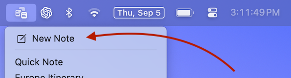
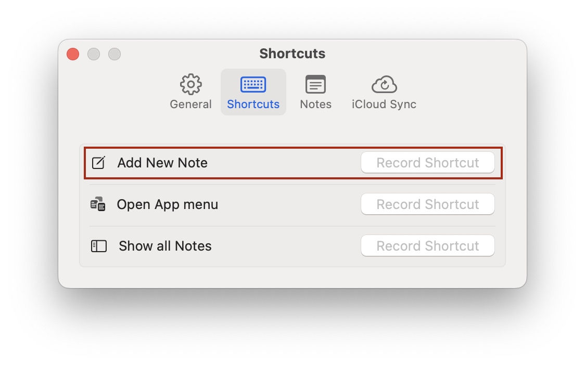
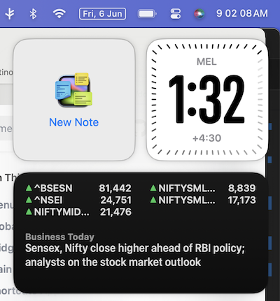
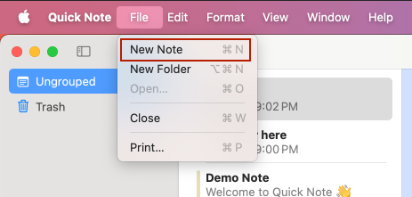
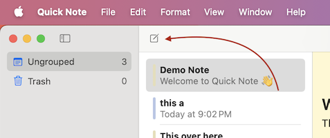
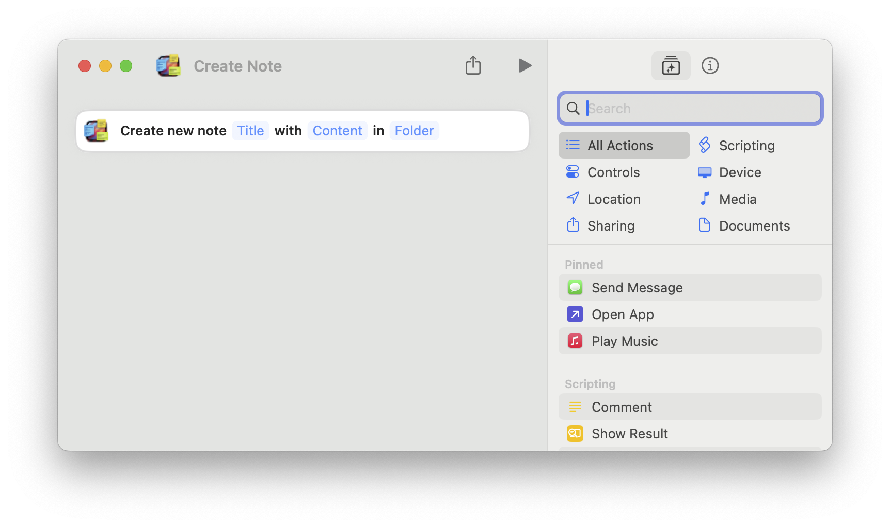

#  Creating a New Note

Quick Note is a powerful tool designed to streamline note-taking. You can create a new note in many different ways, so you can quickly capture ideas no matter how you work.

- **On Mac**: the menubar, global shortcuts, widgets, the main window, the Shortcuts app, Apple Script Editor, Terminal or the Services menu.
- **On iPhone and iPad**: the app itself, the Home Screen icon, Control Center, the Share sheet, Siri, Spotlight or the Shortcuts app.

## On Mac

### Menubar
The default and easiest way to create a new note is to click on the Quick Note menubar icon, located at the top-right corner of your screen, and then select "New Note" from the dropdown menu.



### Global shortcut
You can set a global shortcut to create a new note. A global shortcut allows you to create a new note even while using a different application.
To set a global shortcut, open Quick Note `Settings` and select the 'Shortcuts' tab.



### Widget
You can add a New Note Widget that lets you create a new note from the Widget palette
To add a widget, open the widget palette from the home screen or settings menu, click on `Edit Widgets...`, and add Quick Note.



### Main Window
You can click on the main menu and select `Show all Notes` to open a window.
Click on the new note toolbar item or use the `File` Menu to create a new note.





### Shortcuts App
The Shortcuts app lets you automate tasks across Apple platforms using a visual, no-code interface.
You can add a new Action from the Shortcuts app that will let you create a new note as a part of Shortcut automation



### Apple Script Editor
You can use the `make new note` command from the Script Editor to create a new note.

```
tell application "Quick Note" to open (make new note)
```

### Terminal
Run the script command from Terminal. You can add this to your shell scripts also.
```
osascript -e 'tell application "Quick Note" to open (make new note)'
```

### Services Menu
You can create a new note from the global services menu. To do that, select text in any app and double-tap/right click to open the context menu.
Select `Services` menu, and select "New note in Quick Note menubar app"

## On iPhone and iPad

### In the app
Tap the new note button (the square with a pencil).
On iPhone, it's at the bottom of the screen, next to the search field. On iPad, it's at the top of the sidebar.

### Home Screen
Touch and hold the Quick Note icon on the Home Screen, then tap `New Note`.

### Control Center
Add the `New Note` control to Control Center to start a note from anywhere, without looking for the app first.
To add it, open Control Center, tap `+` at the top-left corner, then tap `Add a Control` and search for Quick Note.

### Share sheet
Send text from any app straight into a new note. Select the text, tap `Share`, then choose Quick Note. The text opens right away in a new note, links and all.

Don't see Quick Note? Scroll to the end of the row of apps and tap `More`.

### Siri and Spotlight
Ask Siri: _"New note in Quick Note"_.

You can also search for Quick Note in Spotlight and tap `New Note` beside the app.

### Shortcuts App
Add the `New Note` action from Quick Note to a shortcut, to create a note as part of your own automations.

:::info

Control Center, Siri, Spotlight and Shortcuts app support need iOS 26 or iPadOS 26 or later.

:::
