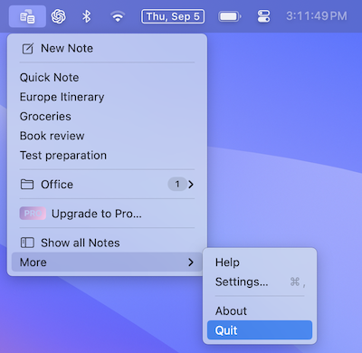

#  Quit App

Quick Note on Mac is a Menubar app that runs in the background. Unlike other apps, Quick Note does not quit simply by closing all the windows.

You can quit the app by following the steps mentioned below

1. Open the main menu
2. Select `More`
3. Tap on `Quit`

## iPhone and iPad
On iPhone and iPad, you don't need to quit Quick Note. If you want to close it anyway, open the App Switcher by swiping up from the bottom of the screen and pausing, then swipe up on Quick Note.
